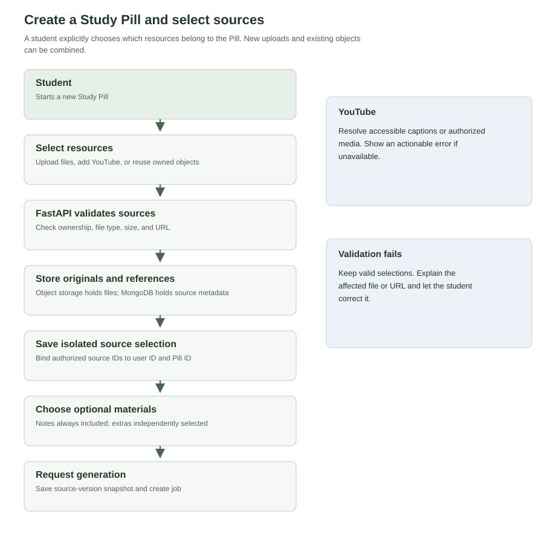
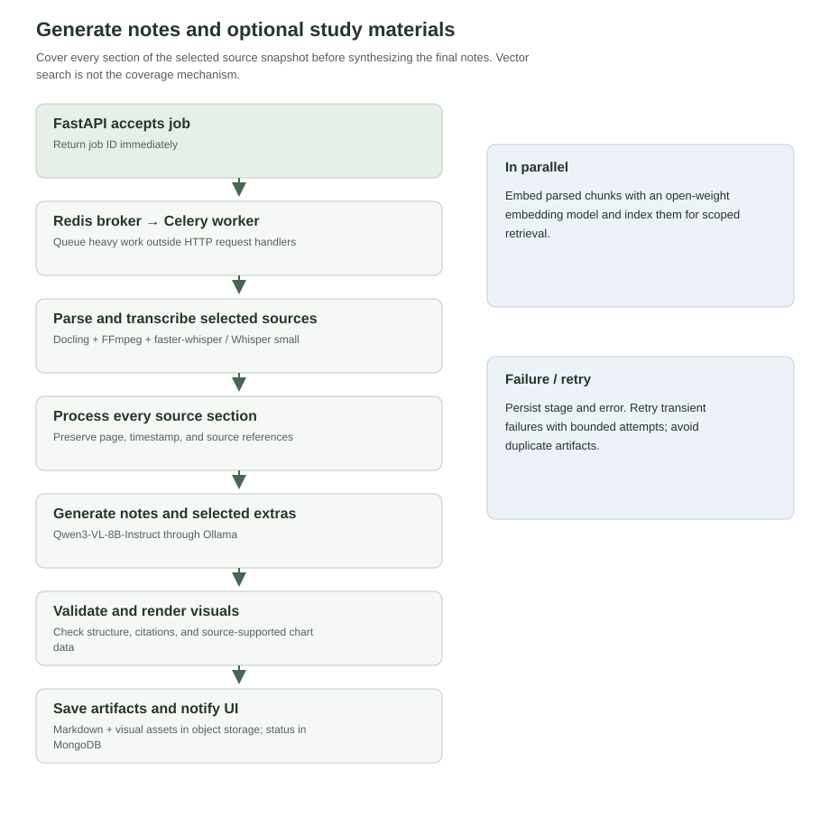
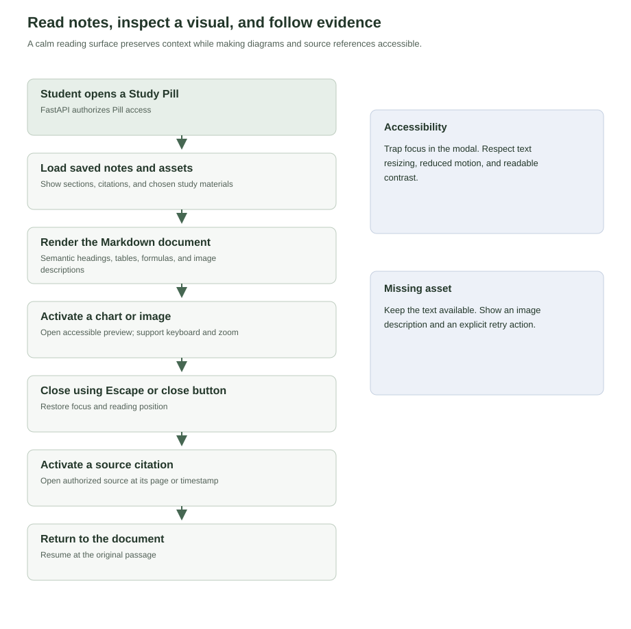
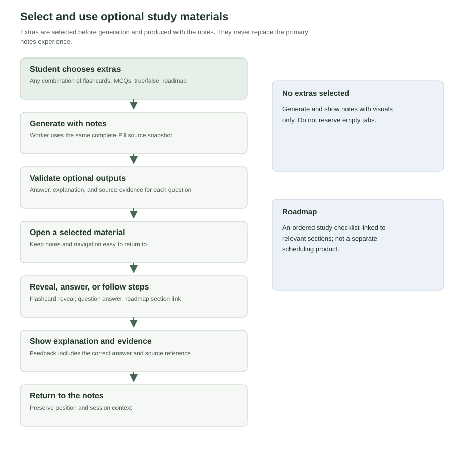
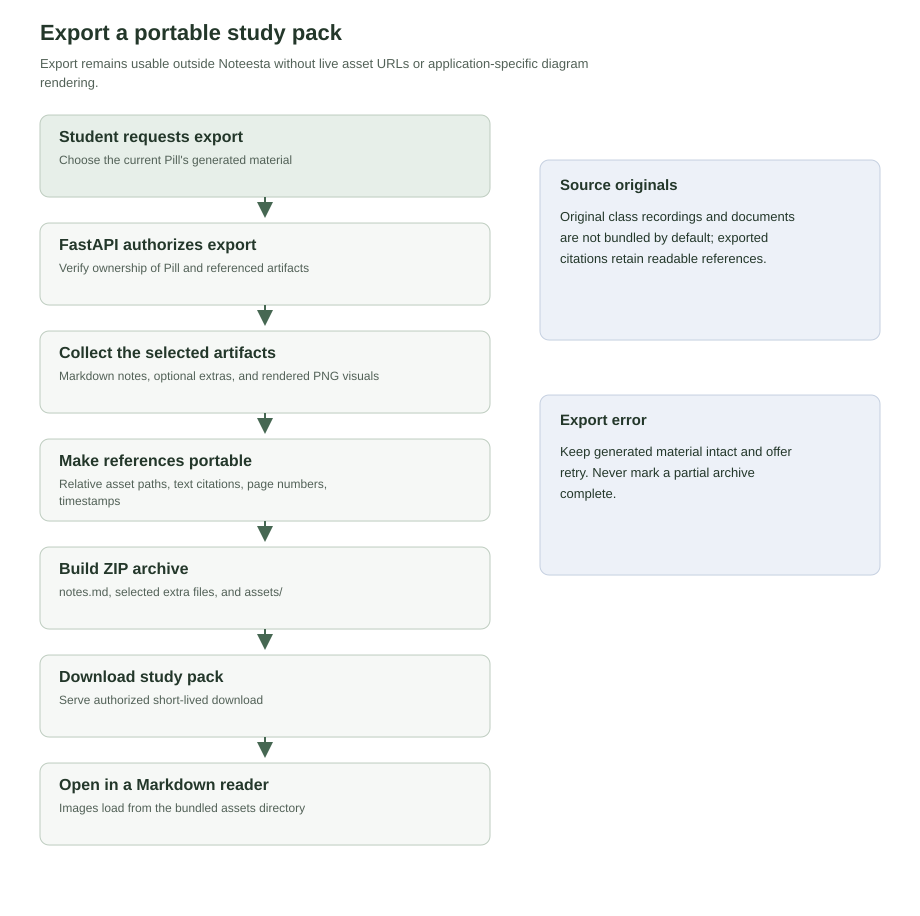
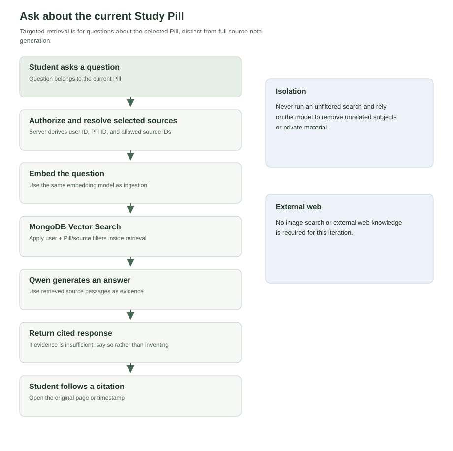

# Noteesta interaction diagrams

[Browse all rendered diagrams](diagrams.html) · [System architecture](system-architecture.md)

The text below describes current behavior. The SVGs and editable Mermaid sources are original design artifacts: they also include proposed behavior such as library-file reuse, immutable source snapshots, exact-page source opening, and stored export downloads. See the [backend guide](backend.md) for the current API contract.

## 1. Create a Study Pill and select sources

A student uploads files and/or provides a YouTube URL, selects a generation model, and chooses study materials. Existing library files cannot yet be selected for a new Pill. The API stores the sources/settings and returns a queued Pill with HTTP 202.

[Editable Mermaid source](diagrams/01-create-study-pill.mmd)

- **YouTube:** The worker fetches accessible English captions, including automatic captions. It fails with an error when none are available; it does not download the video as a fallback.
- **Validation fails:** Keep valid selections. Explain the affected file or URL and let the student correct it.

## 2. Generate notes and optional study materials

Analyze every chunk of the Pill's saved sources before synthesizing notes. Vector search supports targeted chat rather than full-source coverage. Uploaded audio/video are transcribed; video frames are not sampled.

[Editable Mermaid source](diagrams/02-generate-materials.mmd)

- **Indexing:** Embed the collected chunks after source analysis and before note synthesis. This runs sequentially with generation.
- **Failure / retry:** Persist stage and error. Retry transient failures with bounded attempts; avoid duplicate artifacts.

## 3. Read notes, inspect a visual, and follow evidence

A calm reading surface preserves context while making diagrams and source references accessible.

[Editable Mermaid source](diagrams/03-read-and-preview.mmd)

- **Accessibility:** Trap focus in the modal. Respect text resizing, reduced motion, and readable contrast.
- **Visual generation failure:** The worker can complete the notes without a visual. Regenerating the Pill retries generation.
- **Citations:** Show the saved source excerpt and locator. Opening an original at an exact page or timestamp remains planned; original downloads are available through the source library.

## 4. Select and use optional study materials

Flashcards, MCQs, true-or-false questions, roadmap, and interactive 3D are selected before generation. Practice materials use the Pill's saved generation model. Interactive 3D uses the configured Ollama model for its cited brief and a separate OpenAI scene model.

[Editable Mermaid source](diagrams/04-optional-materials.mmd)

- **No extras selected:** Generate and show notes with visuals only. Do not reserve empty tabs.
- **Roadmap:** An ordered study checklist linked to relevant sections; not a separate scheduling product.
- **3D:** Ready scenes load through the owner-scoped `/api/v1/pills/{pill_id}/three-d` route. Unsuitable sources or a generation failure can leave 3D unavailable while the other materials remain usable.

## 5. Export a portable study pack

FastAPI builds the ready Pill's ZIP during the export request. It contains a single `notes.md` with notes and available practice materials, plus PNGs in `assets/` referenced by relative paths. The response streams the ZIP directly; no stored archive or separate short-lived archive URL is created.

[Editable Mermaid source](diagrams/05-export-markdown.mmd)

- **Source originals:** Original recordings and documents are excluded; exported citations retain readable references.
- **3D:** Interactive scene code is excluded from ZIP export.
- **Export error:** Keep generated material intact and offer retry. Never mark a partial archive complete.

## 6. Ask about the current Study Pill

Targeted retrieval is for questions about the selected Pill, distinct from full-source note generation.

FastAPI embeds the question with Ollama, applies user/Pill filters inside Atlas Vector Search, and asks the generation provider/model saved on the Pill to answer from the retrieved passages. A response without sufficient evidence reports that limitation.

[Editable Mermaid source](diagrams/06-grounded-chat.mmd)

- **Isolation:** Never run an unfiltered search and rely on the model to remove unrelated subjects or private material.
- **External web:** No image search or external web knowledge is required for this iteration.

## 7. Organize Pills and manage originals

Collections group the current user's Pills. Metadata updates validate collection ownership; bulk moves and collection deletion use the same stored membership field. Deleting a collection clears membership without deleting its Pills.

The source library lists files and YouTube links attached to Pills. Students can download an available file or delete its stored original while retaining generated notes. Deleted originals cannot be downloaded and may prevent regeneration. YouTube entries remain links and cannot be deleted as stored files.

